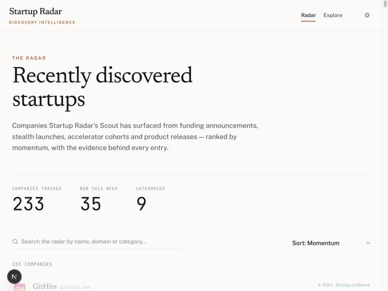

# Startup Radar

A discovery engine for emerging startups: it finds companies from public sources — funding
announcements, accelerator cohorts, stealth launches, product releases — before they're widely
covered, ranks them by how much is actually happening, and attaches a confidence score and a real
evidence trail to every claim it makes. No hand-entered data, no fabricated enrichment.



## Two decisions worth knowing about

**Deterministic over agentic.** The first version of the discovery engine used one Claude call per
category — web search and web fetch to both find and verify candidates. It worked, but one category
took ~20 minutes on a real run, and the worst-case cost per request ran to ~$2+ against a $0.75
budget ceiling. An open-ended agentic loop can't run daily under a fixed, honest cost ceiling. So
discovery is now a fully deterministic pipeline — real RSS/directory feeds, rule-based extraction
and ranking, zero LLM calls anywhere in the path, enforced by a static test. It runs daily,
unattended, for effectively free. AI is reserved for narrow, bounded judgment calls on evidence the
pipeline has already surfaced — not for finding the evidence in the first place.

**A mistake I shipped, caught, and reverted.** A feature once guessed a company's domain from its
name and verified the guess by checking whether the company's name appeared on the resulting
homepage. A precision audit found two of the first ten guesses were wrong in a specific, bad way: a
funded startup called *Ande* matched `ande.com` — actually ANDE, an unrelated forensic DNA-testing
company. A startup called *Travix* matched `travix.com` — an unrelated 450-employee travel agency.
Both passed because the real, different company's own homepage naturally contains its own name —
the check proved a name collision, not an identity match. The feature was reverted completely. The
rule that came out of it: **a wrong domain is worse than a missing company.** An unresolved match is
the correct outcome when evidence is thin, not a bug to paper over.

The full writeup — what I'd do differently if I started over, and why I'm interested in both AI
operations and evaluating startups — is on the site itself: run it locally (below) and open `/about`.

## What it does

- **Discovers** companies deterministically — real RSS/directory feeds, rule-based extraction and
  ranking, **zero LLM calls anywhere in the discovery path**, enforced by a static test.
- **Ranks by Momentum** — a recency-weighted count of distinct real signals (a funding round, a
  launch, a confirmed change in hiring/GitHub/website activity), never a hidden score.
- **Tracks change over time** — Signal Intelligence revisits companies and distinguishes "what we
  saw on first look" from "a confirmed change witnessed over two independent passes," never
  blurring the two.
- **Shows its work** — every company and every event carries a confidence tier and a link to the
  real source it came from.
- **Runs itself** — two separate scheduled jobs (discovery, signal observation) run daily via
  GitHub Actions with no manual intervention, under hard caps that make "zero new companies today"
  a valid, expected outcome rather than something to force.
- **Costs effectively nothing to operate** — the discovery path makes no Anthropic calls at all,
  and the one part of the system that can call an LLM (Phase 1, kept for reference, not the primary
  path) runs under a hard $0.75-per-run budget ceiling with pre-flight reservation.

## Quick start (frontend)

The frontend is a read-only Next.js app over the data Scout (the discovery engine) collects.

```bash
cd frontend
npm install
cp .env.local.example .env.local   # Supabase URL + service-role key, both server-only
npm run dev
```

Open <http://localhost:3000>. Without Supabase credentials it still runs, against a clearly-labeled
sample dataset. See [`frontend/README.md`](frontend/README.md) for the full setup and structure.

## How it's built

```
Source providers (RSS / Google News / YC / Techstars)
        │  SourceItem
        ▼
Deterministic extraction + prefilter + entity clustering     — regex/heuristic, NO LLM
        ▼
Existing-company matching + domain resolution                — read-only against Supabase
        ▼
Deterministic ranking (8 weighted, logged components)
        ▼
Two-track finalist selection (news / directory)
        ▼
Controlled writes — new companies + their initial events only, under hard per-run caps
        ▼
Signal Intelligence — hiring (ATS), GitHub, website-structure observers, revisited daily
```

| Area | What it is |
|---|---|
| `src/funnel/` | The deterministic discovery pipeline — extraction, prefiltering, clustering, domain resolution, ranking. Zero LLM calls, enforced by a static guard test. |
| `src/sources/` | Source providers (RSS feeds, Google News, YC/Techstars directories) and the one shared, polite HTTP fetcher everything goes through. |
| `src/discovery/` | The one controlled write path for new companies — hard caps, no retries without an idempotency key, "zero writes" is a valid outcome. |
| `src/signals/` | Hiring/GitHub/website observation, append-only, with a non-negotiable rule: a metric that couldn't be observed is *unknown*, never defaulted to zero. |
| `src/budget.ts`, `src/ledger.ts` | The $0.75 absolute budget ceiling (Phase 1 only) and the raw-lead ledger — every lead recorded the moment it's found, regardless of what happens to it next. |
| `src/snapshot.ts` | Offline HTTP/DB snapshot + replay — the entire test suite runs with zero network calls and zero spend. |
| `frontend/` | The Next.js product surface — Radar feed, Explore, Company Detail, Methodology, About. Read-only against Supabase; never writes, never calls an LLM. |
| `.github/workflows/` | The two daily scheduled jobs (discovery, signal observation) that run all of the above unattended. |

A fuller, still-current architecture doc — including the two phases this project went through and
why Phase 1 (an earlier, Claude-web-search-based discovery approach, kept in `src/main.ts` for
reference) was replaced — lives in [`CLAUDE.md`](CLAUDE.md).

## Non-negotiables this codebase enforces, not just documents

- No LLM call anywhere under `src/funnel/`, `src/sources/`, or `src/eval/` — a static test fails
  the build if one appears.
- Exactly two files in the whole codebase may write to the database, each one checked by a test
  that inspects every write call by table name.
- A metric a collector couldn't observe is written as *missing*, never as zero — 7 dedicated
  regression tests hold this line.
- A guessed company domain may only be accepted with independent corroborating evidence, never on
  the company's name alone — see the About page for the real case this rule came from.

## Disclaimer

Startup Radar is an evidence-tracking tool, not financial or investment advice. Confidence and
Momentum describe how well-evidenced and how active something appears in public sources — not a
recommendation to invest in, work for, or partner with any company it lists.
